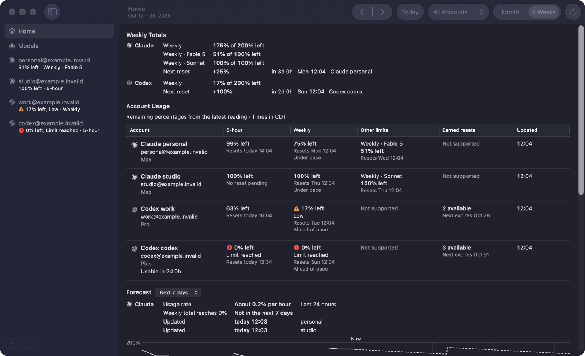
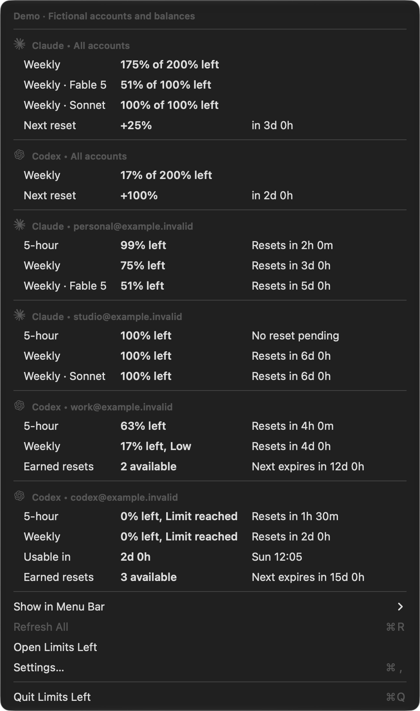

<p align="center">
  
</p>

<h1 align="center">AI Usage Stats</h1>

<p align="center">
  See how much of your Claude and Codex limits are left, on every account, right from your Mac's menu bar. Keep a private history of how you use them, stored only on your Mac.
</p>

<p align="center">
  <a href="https://github.com/ParkerRex/ai-usage-stats/releases/latest">Download</a> ·
  <code>brew install --cask parkerrex/tap/ai-usage-stats</code> ·
  macOS 14 or later · Apple silicon and Intel
</p>



## What it does

- **Menu bar number.** Shows how much quota is left. By default you see the lowest number for Claude and for Codex. Pick the accounts you actually use and each one gets its own number.
- **Menu with every account.** Click the menu bar item for each account's 5-hour, weekly, and model limits, with when each one resets. With two or more accounts of one provider, the menu also shows their weekly total and next reset.
- **Home window.** One table for all accounts, plus a calendar of upcoming resets.
- **Weekly totals and pace.** With two or more accounts of one provider, Home adds up the weekly quota left across them and shows when the next reset comes and how much it gives back. Each account's weekly cell says whether it is ahead of or under pace. Claude and Codex totals are always kept apart.
- **Forecast.** Home keeps each reading and shows how fast your weekly total is going down, when it would reach 0%, and a chart of the next 1 or 7 days. Gaps in the history stay gaps.
- **Models page.** See how each Claude and Codex model behaves in your own work: output speed, steps per turn, thinking share, parallel tool calls, and the shell commands it runs (grep instead of rg, piping into head or tail, inline Python or JavaScript).
- **Many accounts.** Keep several Claude and Codex accounts side by side without touching your everyday logins.

It only reads usage. It never buys credits, changes plans, or sends AI requests to check your usage, and it has no tracking or telemetry.



## Your usage history

The forecast and the Models page come from a history the app keeps on your Mac. Nothing in it is uploaded.

- **What it reads.** Claude Code logs in `~/.claude/projects` and Codex logs in `~/.codex/sessions` and `~/.codex/archived_sessions`, including compressed `.jsonl.zst` files. It reads them in the background after each refresh and skips files that have not changed. Codex logs also fill in earlier Codex quota readings for the account they belong to.
- **What it stores.** Derived facts only: quota readings over time, and for each model response its model, time, and token counts. For each shell command it keeps the length, line count, a few categories (search program, pipe into head or tail, git status or commit, inline script language and purpose), and the program names with every argument removed, such as `grep | head`. A project is a salted hash of its folder path.
- **Identifiers it keeps.** The session, turn, response, and command IDs copied from the logs, so reading a log again replaces rows instead of adding them. The app's own ID for each account, and the Codex account ID of each linked Codex account, so quota readings stay with the right account. Read positions are saved under a salted hash of each log's path.
- **What it never stores.** Prompts, replies, tool output, file contents, command text, or folder names.
- **Where.** `~/Library/Application Support/AI Usage Stats/history.sqlite`. It is kept until you delete it, so it outlasts Claude Code's own logs, which Claude Code deletes after 30 days by default. To clear it, quit the app and delete the files whose names start with `history.sqlite`.

## Install

**With Homebrew:**

```sh
brew install --cask parkerrex/tap/ai-usage-stats
```

**Or download it:** get the `AI-Usage-Stats-<version>.zip` file from the [latest release](https://github.com/ParkerRex/ai-usage-stats/releases/latest), unzip it, and drag **AI Usage Stats** into your Applications folder.

The app is signed and notarized by Apple, so it opens without security warnings.

## Set it up

1. **Open AI Usage Stats** from Applications. A small gauge icon appears in your menu bar. There is no Dock icon until you open the window.
2. **Add a Claude account.** Click the menu bar icon and choose **Add Claude Account…**. Your browser opens claude.ai; sign in and approve. The app shows the account as soon as you finish.
3. **Add a Codex account.** Choose **Open AI Usage Stats**, click **+** below the sidebar (or File > Add Account…), and pick Codex. On a fresh install the menu bar menu also offers **Add Codex Account…**.
   - If the Codex CLI on this Mac is already signed in, choose **Use Current Codex Login**.
   - Otherwise choose **Sign In with a Different Account…**. Terminal opens `codex login`; sign in, and the app picks it up by itself.
   - Codex accounts need the [Codex CLI](https://github.com/openai/codex) or the ChatGPT desktop app installed.
4. **Pick what the menu bar shows.** Click the menu bar icon, open **Show in Menu Bar**, and check the accounts you care about. Choose **Lowest per Provider** to go back to the default.
5. **Arrange accounts.** Choose **Open AI Usage Stats** and drag accounts in the sidebar into the order you like. Right-click an account to delete it.

**Optional: Claude API credits.** Open a Claude account's page and choose **Connect API Credits…**, then sign in to Claude Platform in the window that appears. Passkeys don't work in that window. If Google asks for one, choose **Try another way** and use your password or a code.

**Settings** (launch at login) are under **Settings…** in the menu, or press Command-comma.

## Good to know

- **Experimental readings.** Claude usage and API credits come from endpoints Anthropic hasn't documented, so they can change without notice. Codex usage comes from the Codex CLI.
- **Readings refresh every 5 minutes**, or when you choose **Refresh All**. Old readings say **Last known** so you never mistake them for live numbers.
- **First launch may ask for Keychain access.** That's macOS asking whether the app may read the sign-ins it saved.
- **Uninstall:** `brew uninstall --cask ai-usage-stats`, or drag the app to the Trash.

## Build from source

You need Xcode 27 or later, which includes Swift 6 and the macOS 27 SDK the source uses.

```sh
git clone https://github.com/ParkerRex/ai-usage-stats.git
cd ai-usage-stats
scripts/package_app.sh
open "dist/AI Usage Stats.app"
```

The first build downloads two pinned Swift packages: [GRDB](https://github.com/groue/GRDB.swift) 7.11.1 for the history database and [facebook/zstd](https://github.com/facebook/zstd) 1.5.7 to read compressed Codex logs. The app has no other dependencies.

Local builds use your own development certificate and are not notarized. [docs/RELEASING.md](docs/RELEASING.md) covers packaging options and the public release steps.

## More

- [Native design](docs/NATIVE-DESIGN.md), [product scope](docs/STRATEGY.md), and [usage analytics plan](docs/USAGE-ANALYTICS-PLAN.md)
- [Validation record](docs/VALIDATION.md), [Claude sources](docs/research/claude.md), and [Codex sources](docs/research/codex.md)
- [Contributing](CONTRIBUTING.md) and [agent guide](AGENTS.md)

[MIT licensed](LICENSE). Copyright 2026 Parker Rex. Not affiliated with Anthropic or OpenAI.
