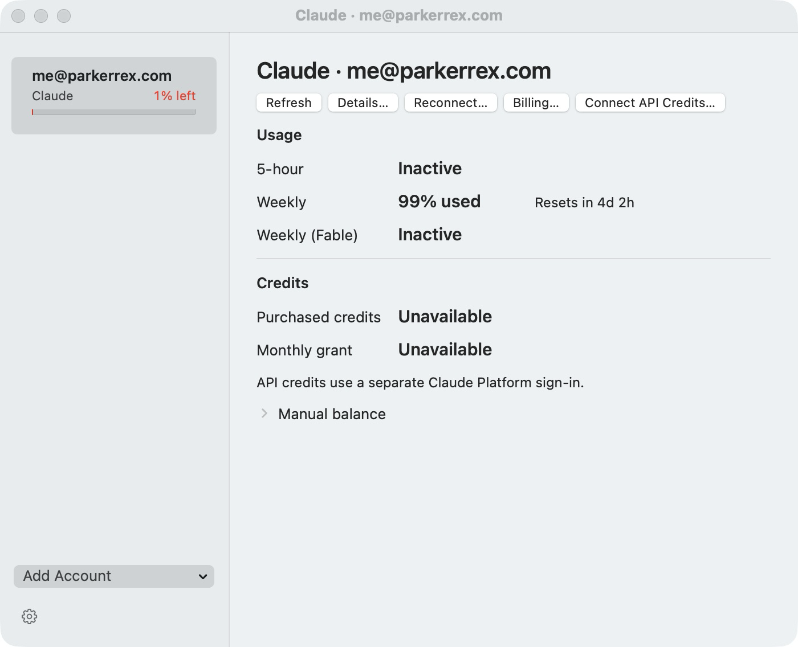
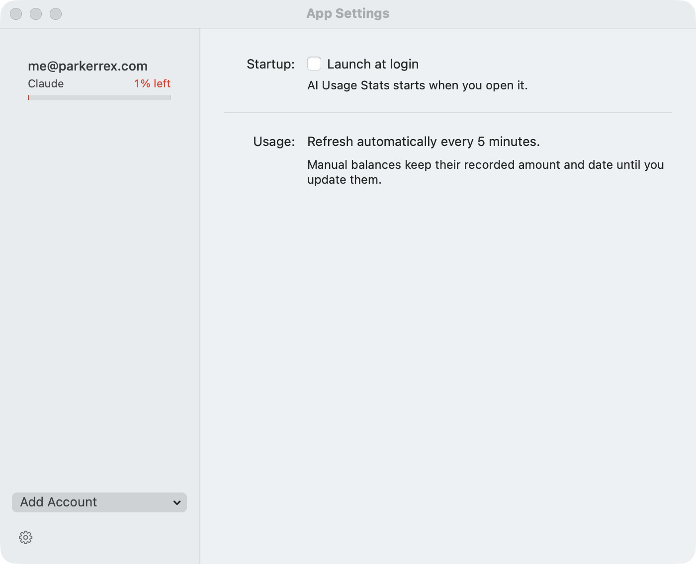

# AI Usage Stats

Claude and Codex usage, reset countdowns, and API credits in your menu bar, with a calendar of account resets. Keep several accounts in one place without replacing your everyday CLI login.

**Native AppKit · macOS 14+ runtime · Swift 6 · No external Swift dependencies**



Clicking the menu bar item opens a standard macOS menu. Each account has a native section heading with its provider logo and verified email, followed by aligned usage and credit readings. Quota rows explicitly show the percentage used and a reset countdown; the compact menu bar preview shows provider logos with remaining-quota percentages. Full provider names and remaining-capacity meaning stay in its tooltip and accessibility text. **Manage Accounts…** opens the existing Accounts window. Tooltips and **Details…** keep exact dates and sources available. First-run account setup, Refresh, and Quit use standard status-menu commands. The bottom-left settings icon, app-menu Settings command, and Command-comma open App Settings inside the same window. Its title follows the selected account or settings screen. Open windows are available through Command-Tab; closing the window returns to menu-bar-only use.

Manage Accounts opens Home, with two-week and month calendars. Each reported reset shows its provider icon, remaining percentage, account identity, and time. Hover or activate an event for account details. The account table shows reported plans, all quota windows, earned reset counts and expiry, and reading times. The account filter applies to both views. Calendar percentages reflect the latest reading; resets are not projected into later cycles.

Account rows show the lowest complete current quota remaining, with green above 20%, orange from 10% through 20%, and red below 10%. Unknown, inactive, stale, unavailable, and sign-in states stay explicit. Refresh is beside a native Account menu; right-click an account or press Delete in the sidebar to remove it with confirmation. Accounts and App Settings have a 960 × 760 point maximum content size; Home can expand to 1680 × 1040 points.

## App Settings

The sidebar settings icon opens startup and refresh information inside the same window.



These screenshots show the packaged app with a connected account on macOS 27.0.1, captured October 13, 2026. Usage and reset times reflect that moment; unavailable credit balances remain visible.

## What it reads

| Source | Data | Connection |
| --- | --- | --- |
| Claude subscription (experimental) | Quota used and reset countdowns | Separate browser sign-in for each app account, followed by direct quota reads. Uses private OAuth endpoints. |
| Claude Console (experimental) | Purchased API balances, invoice-identified monthly subscription grants, and other promotions with scope and expiry | Separate Console sign-in for each account. Uses private billing endpoints. |
| Codex | Usage windows, credit units, and earned quota resets with expiry | Automatic reads through the installed native CLI's app-server interface. |
| OpenAI API | Prepaid balance and optional expiry | Manual entry with a source date and a link to official billing. |

Subscription limits, API money, and Codex credit units stay separate. Missing readings show as unavailable; old readings retain their timestamps and stale state. If monthly metadata fails, purchased balances still refresh and the last verified monthly reading remains explicitly stale. Promotional grants keep their reported scope instead of all being labelled monthly credits.

## Build and install

The app targets macOS 14 or later. Building requires Swift 6. Verification used the macOS 27 SDK and Swift 6.4; macOS 14 runtime remains untested. Claude subscription connections use a browser sign-in. Codex connections require the installed Codex CLI.

```sh
git clone https://github.com/ParkerRex/ai-usage-stats.git
cd ai-usage-stats
scripts/package_app.sh
open "dist/AI Usage Stats.app"
```

For local installation, move `dist/AI Usage Stats.app` to Applications and open that copy. Quit an older instance before launching a new build.

Packaging uses the selected existing local development identity, falling back to ad hoc signing when none is configured, and creates an app and ZIP for local use. Public downloads are not available yet, and the local build is not notarized. See [local packaging](docs/RELEASING.md) for version and architecture options.

## Connect accounts

On first run, click the menu bar item and choose **Add Claude Account…** or **Add Codex Account…**. The setup dialog explains the selected connection source and prerequisites. Choose **Manage Accounts…** to manage existing accounts, then select an account in the sidebar to view compact Usage and Credits rows. Direct buttons provide Refresh, Details, Reconnect, Billing, and API Credits; account removal is in the sidebar context menu. Manual balance stays collapsed until needed.

Menu headings use the provider logo and verified sign-in email. When the provider returns no email, the heading uses the saved account name; its tooltip and Connection Details show **Email unavailable**. The menu, account list, and details use the verified login email for both providers. Legacy labels remain only as a fallback when the login email is unavailable; there is no name editor or name prompt. Long emails retain their full value in native menu text and tooltips.

- **Claude subscription:** choose **Add Claude Account…** and complete the subscription sign-in at **claude.ai** in your browser while its confirmation sheet remains attached to Manage Accounts. The app requests usage after sign-in and keeps this account separate from your everyday Claude Code login. No terminal session or model response is needed. Existing status-line capture profiles remain available; reconnect one to switch it to direct reads while preserving its stored profile identity.
- **Claude monthly/API credits:** select the Claude account, choose **Connect API Credits…** (or **API Credits…** for an existing connection), sign in to **platform.claude.com** in the same management window, then choose **Continue**. Select the organization that holds your grant if prompted, then choose **Connect**. This authentication is separate from Claude subscription sign-in at **claude.ai**. **Back** returns to the same account. Monthly grants are identified by matching a specifically named monthly invoice to its promotional balance and expiry. Other promotions remain separate. If Console reports an eligible plan as **Not linked**, **Billing…** opens the official page where you can link or claim it yourself; monitoring performs no claim, plan change, or purchase.
- **Codex:** choose **Add Account → Connect Codex** and complete its official CLI login. Each profile uses a separate app-owned `CODEX_HOME`. Finish one login before starting another.
- **Manual balances:** expand **Manual balance**, select an API credit category, and enter its amount, confirmation date, and optional expiry from the billing dashboard.

If macOS denies access to a saved subscription sign-in, open **Manage Accounts… → Details… → Allow Keychain Access…**. This explicit action reads the existing credential; it does not start another sign-in or replace tokens. Background refresh does not request Keychain permission. Use a consistent local signing identity when rebuilding; changing an ad hoc build can invalidate earlier approvals.

The experimental subscription connection stores its own OAuth grant in a separate Keychain item for each app account. It does not refresh, replace, or export your existing Claude Code credentials. Reconnecting an older capture profile restores its previous status line when the app's wrapper is unchanged. User replacements are preserved; incomplete cleanup retains its recovery record and shows an account-specific message. If sign-in or refresh fails, the connection shows the error and a recovery action. Provider-reported inactive quotas remain visible as inactive and do not affect current usage summaries.

When an older profile first receives a verified identity, its earlier Console credit connection is cleared. Saved manual balances remain available in the editor for confirmation through **Save Balance**, and stay out of the current readings until confirmed. Reconnecting an already verified account preserves its confirmed balances.

The Claude Platform connection keeps its login in a separate persistent WebKit store for each app account. Its browser is embedded in Manage Accounts; App Settings shares that same window. Closing the window parks browser activity without signing out. It does not export cookies into the saved account file. Disconnecting stops automatic reads while retaining the browser login for reconnecting. Removing a Codex profile removes monitoring data and leaves the CLI login intact.

The app only monitors usage. It does not purchase credits or send model requests as a probe. There is no telemetry.

## Current limits

Claude subscription and Console connections are experimental. Their private endpoints can change. A new usage-only grant and current subscription quota were verified for one account on the tested Mac. Multiple live accounts, automatic renewal, and live Console billing retrieval remain unverified. Returned fields depend on the account, plan, and provider version. OpenAI API prepaid balances use manual entries.

Read the [validation record](docs/VALIDATION.md), [Claude sources](docs/research/claude.md), and [Codex sources](docs/research/codex.md) for the checked behavior and data boundaries. [Product scope](docs/STRATEGY.md) and [native design](docs/NATIVE-DESIGN.md) explain the intended direction.

Contributions are welcome. Read [CONTRIBUTING.md](CONTRIBUTING.md) and [AGENTS.md](AGENTS.md). [MIT licensed](LICENSE), copyright 2026 Parker Rex.
