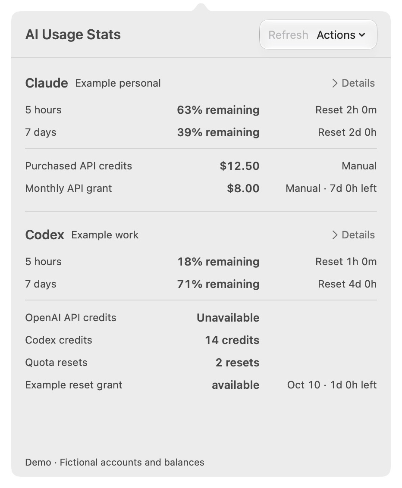

Claude and Codex usage, reset countdowns, and API credits in your menu bar. Keep several accounts in one place without replacing your everyday CLI login.

**Native AppKit · macOS 14+ runtime · Swift 6 · No external Swift dependencies**

Aligned account rows keep quotas and balances easy to compare. Details shows exact dates and sources. On macOS 26+, the Refresh and Actions controls use native Liquid Glass, with a plain fallback for Reduce Transparency and Increase Contrast.

## What it reads

| Source | Data | Connection |
| --- | --- | --- |
| Claude Code | Quota remaining and reset countdowns | Automatic capture from its status line, after Claude returns a new reading. |
| Claude Console (experimental) | Purchased API balances and promotional grants, including returned scope and expiry | Separate Console sign-in for each account. Uses private billing endpoints. |
| Codex | Usage windows, credit units, and earned quota resets with expiry | Automatic reads through the installed native CLI's app-server interface. |
| OpenAI API | Prepaid balance and optional expiry | Manual entry with a source date and a link to official billing. |

Subscription limits, API money, and Codex credit units stay separate. Missing readings show as unavailable; old readings retain their timestamps and stale state. Promotional grants keep their reported scope instead of all being labelled monthly credits.

## Screenshot

<a href="assets/screenshots/menu-bar.png"></a>

Demo data in the running native app.

## Build and install

The app targets macOS 14 or later. Building requires Swift 6 and the macOS 26 or later SDK, such as Xcode 26+. Verification used the macOS 27 SDK and Swift 6.4; macOS 14 runtime remains untested. The app uses installed Claude Code and Codex CLIs for their account connections.

```sh
git clone https://github.com/ParkerRex/ai-usage-stats.git
cd ai-usage-stats
scripts/package_app.sh
open "dist/AI Usage Stats.app"
```

For local installation, move `dist/AI Usage Stats.app` to Applications and open that copy. Quit an older instance before launching a new build.

Packaging produces an ad hoc signed app and ZIP for local use. Public downloads are not available yet, and the local build is not notarized. See [local packaging](docs/RELEASING.md) for version and architecture options.

## Connect accounts

Choose **Actions → Accounts** in the menu bar panel. Select an account in the sidebar to edit its name, connection, or manual balances.

- **Claude:** choose **Add Account → Connect Claude** and select an existing Claude Code configuration directory. Each account needs its own `CLAUDE_CONFIG_DIR`. The app installs a quota-capture status line and preserves the previous command. Its helper is copied to Application Support, so moving the app does not break that command. Usage appears after a new Claude response.
- **Claude API credits:** select the Claude account, choose **Connect API Credits**, sign in to the official Console, and choose the organization. Purchased balances and promotional grants are separate from Claude subscription quota.
- **Codex:** choose **Add Account → Connect Codex** and complete its official CLI login. Each profile uses a separate app-owned `CODEX_HOME`. Finish one login before starting another.
- **Manual balances:** expand **Manual balance**, select an API credit category, and enter its amount, confirmation date, and optional expiry from the billing dashboard.

The Console connection keeps its login in a separate persistent WebKit store for each app account. It does not export cookies into the saved account file. Disconnecting stops automatic reads while retaining the browser login for reconnecting. Removing a Codex profile removes monitoring data and leaves the CLI login intact.

The app only monitors usage. It does not purchase credits or send model requests as a probe. There is no telemetry.

## Current limits

The Console connection is experimental, and live signed-in billing retrieval is still unverified. Returned fields depend on the account, plan, and CLI version. OpenAI API prepaid balances use manual entries.

Read the [validation record](docs/VALIDATION.md), [Claude sources](docs/research/claude.md), and [Codex sources](docs/research/codex.md) for the checked behavior and data boundaries. [Product scope](docs/STRATEGY.md) and [native design](docs/NATIVE-DESIGN.md) explain the intended direction.

Contributions are welcome. Read [CONTRIBUTING.md](CONTRIBUTING.md) and [AGENTS.md](AGENTS.md). [MIT licensed](LICENSE), copyright 2026 Parker Rex.
