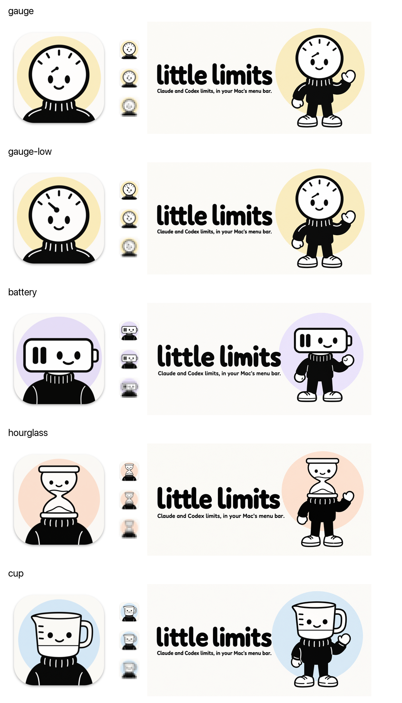

# Little Limits brand

Little Limits is part of the little family, next to Little Worker, [Little Mac Stats](https://github.com/Little-AI-Company/little-mac-stats) and Little Logbook. Each product is a small character whose head is an everyday object, in a black hoodie, on a soft pastel circle over warm paper. Little Worker's Lou has a TV head on sand. Little Mac Stats has a meter head on lavender. Little Limits has a honey box head like Lou's TV, with a small dial on top whose needle points near empty, on butter yellow: a little is left.



## The character

Redrawn on November 17, 2026. Parker found the November 2 drawing ugly, and Cmd-Tab showed dead white space round the app icon, so the character was redrawn from an approved sketch as a sister of Lou and the app icon was made full bleed. The earlier drawings are in git history. `character/limits-character-sheet.png` is the model sheet: turnaround, colours, eight expressions and six poses.

- A chunky rounded box head like Lou's TV, in honey yellow with its depth showing on the left, holding a cream face plate with rounded corners.
- On top, where Lou has antennas, a small half-round dial: cream face, black rim, five short ticks, a coral low end on the left, and a short black needle on a round hub at the bottom middle, pointing down and to the left at the coral end.
- Small solid black oval eyes with no highlight, soft pink blush, a small calm smile.
- A black hoodie with the hood behind the neck and two cream drawstrings, puffy white gloves, and white sneakers when the feet show.
- Lou's hand: confident dark line art (about #111) with soft painted shading, and a thin line of Paper round the figure. No gloss, glow, sparkles or text.

The banner, social preview and lockups still show the November 2 character. They need new art drawn round the existing lettering.

## Palette

| Name | Hex | Use |
| --- | --- | --- |
| Paper | #FBFAF7 | Light ground: banner, website, the thin line round the figure |
| Night | #1E1E1E | Dark ground: dark lockup, website dark mode |
| Butter | #F6ECC6 | Ground of the Paper app icon, to every edge |
| Honey circle | #F2D98A | The circle behind the character on the Paper icon |
| Honey | #E2AE3C | The box head |
| Face plate | #FFF9F0 | The face plate and the dial face |
| Coral | #E8907A | The low end of the dial |
| Night icon | #2B2A28 | Ground of the Night app icon, with the muted circle #5A4A26 |
| Butter accent | #F4DC8A | Website buttons and the gauge arc |
| Accent ink | #7A5600 | Website links and focus on Paper (6.4:1) |
| Ink | #0B0B0B | Words on Paper |
| Character ink | #121312 | The needle, hub and eyes the app draws on the loading picture |
| Off-white | #F4F1EA | Words on Night |

## Files

| File | What it is |
| --- | --- |
| `character/limits-character-sheet.png` | The model sheet, 1536 x 1024. Every other picture is drawn from it |
| `app-icon/artwork/paper.png` | The app icon art, 1024 px and full bleed: the character from the chest up on the honey circle, butter to every edge. It is `Resources/AppIcon.icon/Assets/limits.png` |
| `app-icon/artwork/night.png` | The same drawing on #2B2A28 with the muted circle. It is `Resources/AppIcon.icon/Assets/limits-dark.png`; `limits-tinted.png` is a gray copy of it |
| `app-icon/artwork/paper-small.png` | The head alone with three bold ticks and a thick needle, for 16 and 32 px, on butter to every edge |
| `app-icon/artwork/night-small.png` | `paper-small.png` with the butter ground replaced by #2B2A28 |
| `app-icon/paper.png`, `paper-small.png`, `night.png`, `night-small.png` | The artwork masked to the macOS icon shape (an 824 px rounded square with a 185.4 px radius, centred in 1024 px, transparent outside, no shadow), made by `scripts/compose_icon_master.sh`. `night.png` and `night-small.png` make `Resources/AppIconNight.icns`. `../app-icon.png` is a copy of `paper.png` |
| `character/gauge-head-blank.png` | The icon drawing with no needle, hub or eyes, lined up pixel for pixel with `artwork/paper.png`. The app crops it to the honey circle as `Sources/AIUsageStats/Resources/Character/gauge-head-blank.png` (384 px) and draws the needle, hub and eyes on it for the Models page loading animation |
| `character/wave.png` | The whole character waving on its honey circle on Paper |
| `banner.png` | README banner, 1536 x 768: the November 2 character waving on its butter circle, with the words below |
| `social-preview.png` | 1280 x 640 copy of the banner, for GitHub and link previews |
| `lockup/lockup-light.png`, `lockup-dark.png` | The November 2 icon drawing on its butter circle and the wordmark, 2000 x 500, on Paper and on Night |
| `concepts/` | The five first-round concepts. The owner chose the gauge with the needle low |
| `prompts/` | The exact prompts. `icon-redo-2026-11-17.md` made the current character, icons and loading picture. The others made the concepts, banner, social preview and lockups |

The wordmark is raster art from Codex, not a font file. To make a new size, crop or scale the lockup or banner instead of typing it.

## How it was made

### November 17, 2026 redraw

One Codex job (the built-in image tool) drew the sheet, the icon, the dark icon, the small icon, the blank icon and the waving picture from `prompts/icon-redo-2026-11-17.md`, with the approved sketch and Lou's and Folio's character sheets and icons attached. Afterwards, with Pillow:

- Every file was saved again with pixels only, with no C2PA, EXIF or text chunks.
- The white line round the small icon's head was thinned to 3 px, as the prompt asks, so it is not a thick sticker border.
- The Night small artwork replaces the small icon's butter ground with #2B2A28.
- The loading picture is `gauge-head-blank.png` cut to the square round the honey circle (centre 507.2, 482.6, radius 448.5 in the 1024 px drawing) and scaled to 384 px. The needle, hub and eyes were measured by comparing the icon with the blank, which is lined up with it: in the 384 px crop the hub is at (0.5181, 0.2000) of the side with radius 0.0290, the needle is 0.1333 long and 0.0229 wide and rests at -113 degrees, and the eyes are at x 0.4511 and 0.6736, y 0.5223, 0.0598 wide and 0.1016 tall. The needle sweeps from -113 to 113 degrees, from the coral end along the dial floor to the other side.

Each picture was checked at full size and at 64, 32 and 16 px. The prompts for pictures no longer shipped are in git history.

### November 2, 2026 redraw

Parker asked for the character, icons, social preview and loading picture in the Little Worker cast style. Two headless Codex jobs (Codex CLI 0.164.0, the built-in image tool) on Parker's M1 Max, each in its own empty folder under `/tmp`. Each prompt was its job file followed by `prompts/cast-style-2026-11-02.md`. Attached with `-i`: Lou's character sheet and pose sheet, Lou at rest, waving and done, the Little Worker GitHub social preview and Mac app icon (all from the Little Worker brand page files), and the October 29 `app-icon/artwork/paper.png`. Job 2 had the new sheet attached first.

- Job 1 drew the sheet. Its needle is long and covers the leftmost tick, so job 2 asked for a short needle that stops before it.
- Job 2 drew the icon, the small icon, rest, wave, walk, the head alone and the blank bust. All were on model on the first try.
- Codex painted the bezel and hoodie warm brown (about #312921) where Lou's are near black. One tone change, the same for every file, fixed that: each pixel darker than 30 percent luminance becomes neutral grey at luminance to the power 1.3, the change fades out between 30 and 55 percent, and lighter colours are unchanged. With ImageMagick 7.1.2: `-fx 'lum=0.299*r+0.587*g+0.114*b; wt=lum<0.30?1:(lum>0.55?0:(0.55-lum)/0.25); wt*pow(lum,1.3)+(1-wt)*u'`.
- The small artwork is the small icon cropped to 894 px round the head, with the Paper corners filled with butter. The Night artwork replaces the Paper ground with #33312E: a flood fill from the corners at 5 percent fuzz, shrunk 1 px and softened 0.8 px, so the soft edges carry no light fringe. Then `scripts/compose_icon_master.sh` for all four and `scripts/create_app_icon.sh` for both `.icns` files.
- The banner, social preview and lockups reuse the October 29 lettering pixel for pixel, cut from the old banner by its darkness. No image model drew any word.
- The loading picture's needle, hub and eyes were measured by comparing the icon with the blank bust, which Codex drew in the same place. In the 384 px crop the hub is at (0.5037, 0.3824) of the side, the ticks sit at -56, -29, 0, 30 and 56 degrees from it, and the needle at rest points at -56 degrees.

Each picture was checked at full size and at 64, 32 and 16 px, and every word of the banner, social preview and lockups was checked.

### October 29, 2026 redraw

One headless Codex job on the M4 (`codex exec`, the built-in image tool) drew six pictures from `prompts/redraw-2026-10-29.md`, with Lou's character sheet from Little Worker, the first version's `app-icon/artwork/paper.png` and `banner.png` attached with `-i`. A script then:

- kept every word of the banner, social preview and lockups exactly as before and put the new character on the same butter circle,
- cropped the small artwork, made the Night artwork by swapping the Paper ground for #33312E, placed all four on the macOS icon grid (824 px body, 185.4 px radius, the same drop shadow as `scripts/compose_icon_master.sh`) and made the website copies,
- and `scripts/create_app_icon.sh` made both `.icns` files on the M4.

Nothing was retouched by hand. Website images changed content, so they have new `-v2` names (see `website/_headers`).

### First version, October 20, 2026

Codex image generation, headless, on October 20, 2026, with Codex CLI 0.163.0. Each job ran in its own empty folder, with the sibling products' art attached as style references:

```sh
codex exec --sandbox workspace-write --skip-git-repo-check -C <empty-folder> \
  -i assets/branding/concepts/gauge-low-icon.png \
  -i <little-ci>/assets/icon.png -i <little-worker>/docs/brand/oauth/app-icon-512.png \
  - < assets/branding/prompts/icon.md
```

- `prompts/concepts.md` made the first round. For each concept, only the character paragraph and the pastel accent changed: gauge on butter yellow, battery on lavender, hourglass on peach, measuring cup on sky blue. The gauge job produced two icons; the second, with the needle low, became its own concept.
- `prompts/icon.md`, `prompts/banner.md`, and `prompts/lockup.md` made the finals, with the chosen concept attached first. The banner job also had the first-round gauge banner and the Little CI banner attached; the lockup job had the Little CI banner.
- The Night icons, the icon grid, and every resized website copy were made with ImageMagick 7.1.2 from these files. Nothing was retouched by hand.

Each output was checked by eye at full size and at 64, 32, and 16 px, and every word was checked for spelling.
