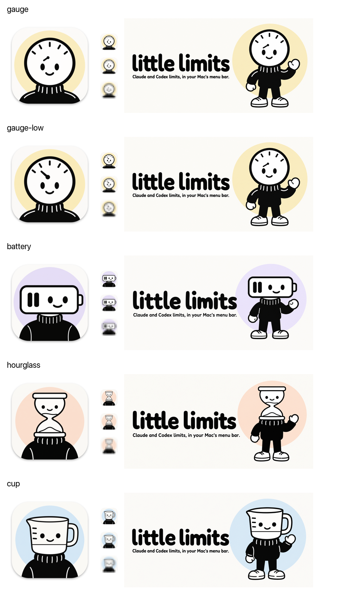

# Little Limits brand

Little Limits is part of the little family, next to Little Worker, [Little Mac Stats](https://github.com/Little-AI-Company/little-mac-stats) and Little Logbook. Each product is a small character whose head is an everyday object, in a black hoodie, on a soft pastel circle over warm paper. Little Worker's Lou has a TV head on sand. Little Mac Stats has a meter head on lavender. Little Limits has a gauge head on butter yellow, with the needle near empty: a little is left.



## The character

Redrawn on November 2, 2026 to match the Little Worker cast on [thelittleworker.com/brand](https://thelittleworker.com/brand), so the gauge stands beside Lou as one cast. Same concept and colours as before; the earlier drawings are in git history. `character/gauge-character-sheet.png` is the model sheet: turnaround, eight expressions and eight poses.

- A round dial-gauge head: a thick black bezel with its depth showing on the left, a warm cream dial, five ticks along the top, and a short needle on a round hub pointing at the leftmost tick. The needle stops short of that tick, so all five show.
- Small solid black dot eyes with no highlight, soft pink blush, a small calm smile at rest and an open smile with a pink tongue when happy.
- A black hoodie with the hood behind the neck and two short drawstrings, puffy white gloves, and white sneakers when the feet show.
- Hand-inked dark line art (about #121312), slightly soft, with a little weight variation. Soft painted shading that gives the head volume. No gloss, glow, sparkles or text. Lots of empty space.

## Palette

| Name | Hex | Use |
| --- | --- | --- |
| Paper | #FBFAF7 | Light ground: icon, banner, website |
| Night | #1E1E1E | Dark ground: dark lockup, website dark mode |
| Night icon | #33312E | Ground of the Night app icon, lifted so the black outline still shows |
| Butter | #F6ECC6 | The circle behind the character, in light and dark. The November 2 drawings paint it a little deeper, about #F6E6BB |
| Butter accent | #F4DC8A | Website buttons and the gauge arc, where the paler circle color would disappear |
| Accent ink | #7A5600 | Website links and focus on Paper (6.4:1) |
| Ink | #0B0B0B | Words on Paper |
| Character ink | #121312 | Line art, and the needle, hub and eyes the app draws on the loading picture |
| Off-white | #F4F1EA | Words on Night |

Butter is close to Little Worker's sand (#F2E6D0). If the two apps need to look more different side by side, make the circle a stronger yellow.

## Files

| File | What it is |
| --- | --- |
| `app-icon/artwork/paper.png` | Full-bleed 1024 px icon artwork from Codex: head and shoulders at rest on the butter circle |
| `character/gauge-character-sheet.png` | The model sheet, 1536 x 1024: turnaround, expressions and poses. Every other picture is drawn from it |
| `character/rest.png`, `wave.png`, `walk.png`, `mark.png` | At rest, waving, walking, and the head alone on Paper. `wave.png` is the banner picture |
| `character/gauge-head-blank.png` | The icon drawing with no needle, hub or eyes. The app crops it to the butter circle as `Sources/AIUsageStats/Resources/Character/gauge-head-blank.png` (384 px) and draws the needle, hub and eyes on it for the Models page loading animation |
| `app-icon/artwork/paper-small.png` | Simplified head-only artwork for 16 and 32 px (three ticks, thick needle), cropped so the head fills the square on flat butter |
| `app-icon/artwork/night.png`, `night-small.png` | The two above with the Paper ground replaced by #33312E, so the drawing is identical |
| `app-icon/paper.png`, `paper-small.png`, `night.png`, `night-small.png` | The artwork on the macOS icon grid, made by `scripts/compose_icon_master.sh`. `../app-icon.png` is a copy of `paper.png` |
| `banner.png` | README banner, 1536 x 768: the waving character on its butter circle, centred like Little Worker's GitHub social preview, with the words below |
| `social-preview.png` | 1280 x 640 copy of the banner, for GitHub and link previews |
| `lockup/lockup-light.png`, `lockup-dark.png` | The icon drawing on its butter circle and the wordmark, 2000 x 500, on Paper and on Night |
| `concepts/` | The five first-round concepts. The owner chose the gauge with the needle low |
| `prompts/` | The exact Codex prompts. `cast-style-2026-11-02.md` is the art brief for the current art; `cast-style-2026-11-02-job1.md` and `-job2.md` are the lines put in front of it for each job |

The wordmark is raster art from Codex, not a font file. To make a new size, crop or scale the lockup or banner instead of typing it.

## How it was made

### November 2, 2026 redraw

Parker asked for the character, icons, social preview and loading picture in the Little Worker cast style. Two headless Codex jobs (Codex CLI 0.164.0, the built-in image tool) on Parker's M1 Max, each in its own empty folder under `/tmp`. Each prompt was its job file followed by `prompts/cast-style-2026-11-02.md`. Attached with `-i`: Lou's character sheet and pose sheet, Lou at rest, waving and done, the Little Worker GitHub social preview and Mac app icon (all from the Little Worker brand page files), and the October 29 `app-icon/artwork/paper.png`. Job 2 had the new sheet attached first.

- Job 1 drew the sheet. Its needle is long and covers the leftmost tick, so job 2 asked for a short needle that stops before it.
- Job 2 drew the icon, the small icon, rest, wave, walk, the head alone and the blank bust. All were on model on the first try.
- Codex painted the bezel and hoodie warm brown (about #312921) where Lou's are near black. One tone change, the same for every file, fixed that: each pixel darker than 30 percent luminance becomes neutral grey at luminance to the power 1.3, the change fades out between 30 and 55 percent, and lighter colours are unchanged. With ImageMagick 7.1.2: `-fx 'lum=0.299*r+0.587*g+0.114*b; wt=lum<0.30?1:(lum>0.55?0:(0.55-lum)/0.25); wt*pow(lum,1.3)+(1-wt)*u'`.
- The small artwork is the small icon cropped to 894 px round the head, with the Paper corners filled with butter. The Night artwork replaces the Paper ground with #33312E: a flood fill from the corners at 5 percent fuzz, shrunk 1 px and softened 0.8 px, so the soft edges carry no light fringe. Then `scripts/compose_icon_master.sh` for all four and `scripts/create_app_icon.sh` for both `.icns` files.
- The banner, social preview and lockups reuse the October 29 lettering pixel for pixel, cut from the old banner by its darkness. No image model drew any word.
- The loading picture's needle, hub and eyes were measured by comparing the icon with the blank bust, which Codex drew in the same place. In the 384 px crop the hub is at (0.5037, 0.3824) of the side, the ticks sit at -56, -29, 0, 30 and 56 degrees from it, and the needle at rest points at -56 degrees.

Each picture was checked at full size and at 64, 32 and 16 px, and every word of the banner, social preview and lockups was checked.

### October 29, 2026 redraw

One headless Codex job on the M4 (`codex exec`, the built-in image tool) drew six pictures from `prompts/redraw-2026-10-29.md`, with Lou's character sheet from Little Worker, the first version's `app-icon/artwork/paper.png` and `banner.png` attached with `-i`. A script then:

- kept every word of the banner, social preview and lockups exactly as before and put the new character on the same butter circle,
- cropped the small artwork, made the Night artwork by swapping the Paper ground for #33312E, placed all four on the macOS icon grid (824 px body, 185.4 px radius, the same drop shadow as `scripts/compose_icon_master.sh`) and made the website copies,
- and `scripts/create_app_icon.sh` made both `.icns` files on the M4.

Nothing was retouched by hand. Website images changed content, so they have new `-v2` names (see `website/_headers`).

### First version, October 20, 2026

Codex image generation, headless, on October 20, 2026, with Codex CLI 0.163.0. Each job ran in its own empty folder, with the sibling products' art attached as style references:

```sh
codex exec --sandbox workspace-write --skip-git-repo-check -C <empty-folder> \
  -i assets/branding/concepts/gauge-low-icon.png \
  -i <little-ci>/assets/icon.png -i <little-worker>/docs/brand/oauth/app-icon-512.png \
  - < assets/branding/prompts/icon.md
```

- `prompts/concepts.md` made the first round. For each concept, only the character paragraph and the pastel accent changed: gauge on butter yellow, battery on lavender, hourglass on peach, measuring cup on sky blue. The gauge job produced two icons; the second, with the needle low, became its own concept.
- `prompts/icon.md`, `prompts/banner.md`, and `prompts/lockup.md` made the finals, with the chosen concept attached first. The banner job also had the first-round gauge banner and the Little CI banner attached; the lockup job had the Little CI banner.
- The Night icons, the icon grid, and every resized website copy were made with ImageMagick 7.1.2 from these files. Nothing was retouched by hand.

Each output was checked by eye at full size and at 64, 32, and 16 px, and every word was checked for spelling.
