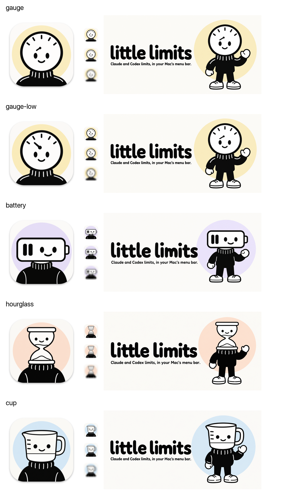

# Little Limits brand

Little Limits is part of the little family, next to Little Worker and [Little CI](https://github.com/Little-AI-Company/little-ci). Each product is a small character in black line art whose head is an everyday object, on a soft pastel circle over warm paper. Little Worker's Pip has a TV head on sand. Little CI has a server-box head on mint. Little Limits has a gauge head on butter yellow, with the needle near empty: a little is left.



## The character

- A round dial-gauge head with a thick black rim, a few ticks along the top, and a short needle pointing at the leftmost tick.
- The family face: two solid black oval eyes and a small smile.
- A black ribbed turtleneck. Round white mittens and white sneakers when the full body shows.
- Thick, even black lines with round ends. Flat fills. The figure is black and white only.
- No gradients, gloss, 3D, shading, or texture. Lots of empty space.

## Palette

| Name | Hex | Use |
| --- | --- | --- |
| Paper | #FBFAF7 | Light ground: icon, banner, website |
| Night | #1E1E1E | Dark ground: dark lockup, website dark mode |
| Night icon | #33312E | Ground of the Night app icon, lifted so the black outline still shows |
| Butter | #F6ECC6 | The circle behind the character, in light and dark |
| Butter accent | #F4DC8A | Website buttons and the gauge arc, where the paler circle color would disappear |
| Accent ink | #7A5600 | Website links and focus on Paper (6.4:1) |
| Ink | #0B0B0B | Lines and words on Paper |
| Off-white | #F4F1EA | Words on Night |

Butter is close to Little Worker's sand (#F2E6D0). If the two apps need to look more different side by side, make the circle a stronger yellow.

## Files

| File | What it is |
| --- | --- |
| `app-icon/artwork/paper.png` | Full-bleed 1024 px icon artwork from Codex |
| `app-icon/artwork/paper-small.png` | Simplified artwork for 16 and 32 px: three ticks, thicker needle and rim, larger eyes |
| `app-icon/artwork/night.png`, `night-small.png` | The two above with the Paper ground flood-filled to #33312E, so the drawing is identical |
| `app-icon/paper.png`, `paper-small.png`, `night.png`, `night-small.png` | The artwork on the macOS icon grid, made by `scripts/compose_icon_master.sh`. `../app-icon.png` is a copy of `paper.png` |
| `banner.png` | README banner, 1536 x 768 |
| `social-preview.png` | 1280 x 640 copy of the banner, for GitHub and link previews |
| `lockup/lockup-light.png`, `lockup-dark.png` | Head and wordmark, 2000 x 500, on Paper and on Night |
| `concepts/` | The five first-round concepts. The owner chose the gauge with the needle low |
| `prompts/` | The exact Codex prompts |

The wordmark is raster art from Codex, not a font file. To make a new size, crop or scale the lockup or banner instead of typing it.

## How it was made

Codex image generation, headless, on October 20, 2026, with Codex CLI 0.163.0. Each job ran in its own empty folder, with the sibling products' art attached as style references:

```sh
codex exec --sandbox workspace-write --skip-git-repo-check -C <empty-folder> \
  -i assets/branding/concepts/gauge-low-icon.png \
  -i <little-ci>/assets/icon.png -i <little-worker>/docs/brand/oauth/app-icon-512.png \
  - < assets/branding/prompts/icon.md
```

- `prompts/concepts.md` made the first round. For each concept, only the character paragraph and the pastel accent changed: gauge on butter yellow, battery on lavender, hourglass on peach, measuring cup on sky blue. The gauge job produced two icons; the second, with the needle low, became its own concept.
- `prompts/icon.md`, `prompts/banner.md`, and `prompts/lockup.md` made the finals, with the chosen concept attached first. The banner job also had the first-round gauge banner and the Little CI banner attached; the lockup job had the Little CI banner.
- The Night icons, the icon grid, and every resized website copy were made with ImageMagick 7.1.2 from these files. Nothing was retouched by hand.

Each output was checked by eye at full size and at 64, 32, and 16 px, and every word was checked for spelling.
