# Limits Left brand explorations

Explorations for the rename to Limits Left. The current icon stays as it is: `assets/app-icon.png`, `Resources/AppIcon.icns`, and the files in `assets/branding/` are unchanged. Nothing here is wired into the app or the site yet. The owner picks the icon.

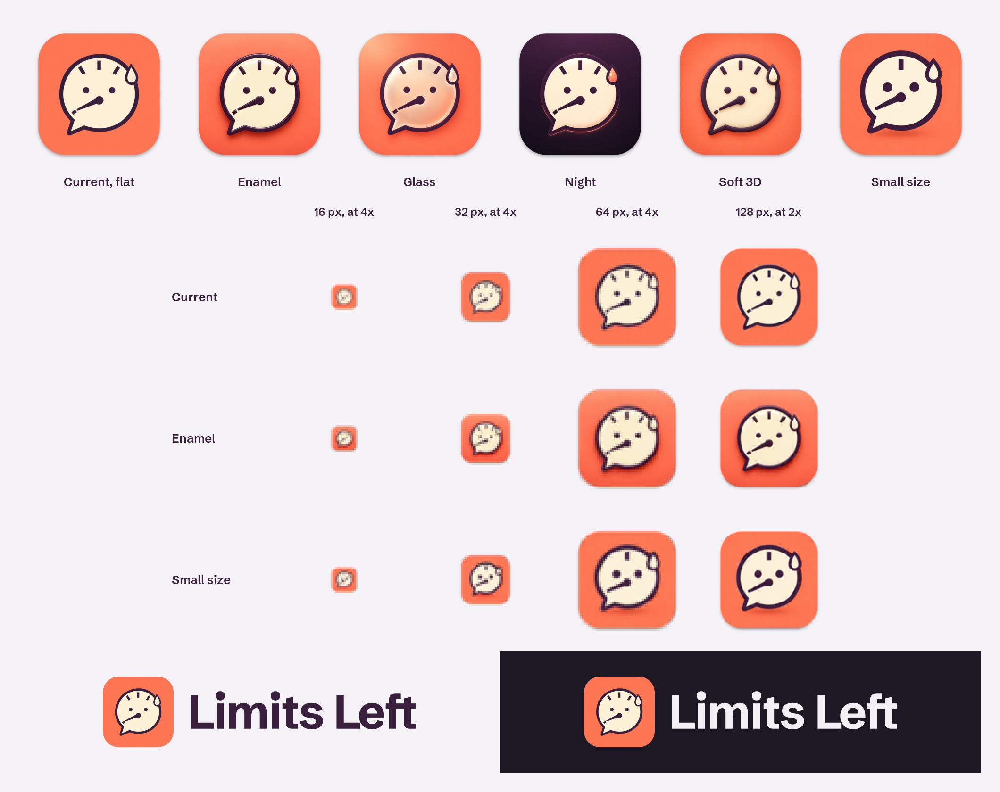

Row 1: the current icon and the five variations, all placed on the same macOS grid. Row 2: straight downscales of the 1024 px masters at 16, 32, 64, and 128 px, magnified with nearest-neighbor so the pixels show. Row 3: the vector lockup on the site's mist and dark grounds.

## Icon variations

Each variation keeps the drawing of `assets/branding/nervous-gauge-artwork.png`: the bubble with its lower-left tail, three ticks, two dot eyes, the needle near empty, the sweat drop, plum ink and coral. Codex generated each one as full-bleed square artwork from that file. `icon-variations/compose_icon.sh` then placed each on the macOS app icon grid: 1024 px canvas, 824 px rounded-square body inset 100 px, 185.4 px corner radius, and a drop shadow 10 px down with a 10 px blur at 30 percent black. Each variation has a 1024 px master and a 256 px preview. `icon-variations/artwork/` keeps the uncomposed 1024 px artwork exactly as Codex generated it, so any master can be composed again, for example with a lighter shadow: `icon-variations/compose_icon.sh icon-variations/artwork/small-size.png small-size.png small-size-256.png`. Composing again with the same ImageMagick 7.1.2 and librsvg 2.63 gives pixels that match the committed masters (PSNR above 52 dB); the PNG bytes can differ.

| Preview | File | Note |
| --- | --- | --- |
| 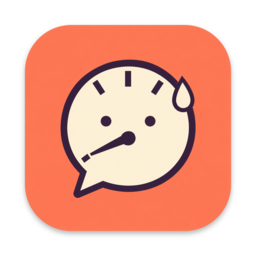 | `current-on-grid.png` | Baseline. The current flat artwork on the same grid, for comparison only. |
| 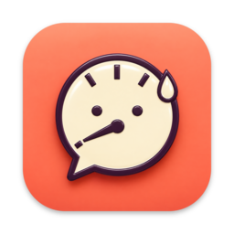 | `enamel.png` | Glazed hard enamel, like a pin. Raised plum rim, a soft highlight across the face, a glossy drop, and a light-to-deep coral gradient. Closest to the original drawing. |
| 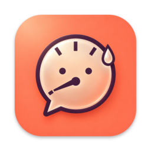 | `glass.png` | Frosted translucent face with a soft rim and light from the top left. Nearest to current macOS glass styling, but the tinted face lowers contrast behind the eyes and needle. |
| 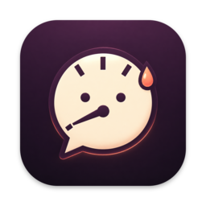 | `night.png` | Deep plum ground (#39203C to #1E1724), coral drop, and a faint coral rim light. Matches the site's dark mode. Best kept as an alternate or dark-appearance icon. |
| 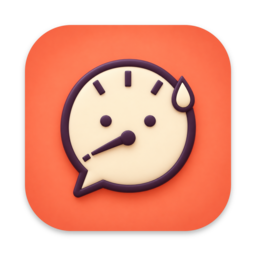 | `soft-3d.png` | Matte clay or vinyl with rounded bevels and small contact shadows. Friendly, but softer edges lose some definition below 64 px. |
| 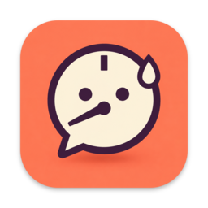 | `small-size.png` | Simplified for 16 to 32 px. One top tick, no tick at the needle tip, thicker outline and needle, larger eyes. Only for the smallest icon slots. |

`icon-variations/enamel-grid-keylines.png` shows the enamel variation over the grid keylines: the body outline, the 824 px square, two circles, and the center lines.

## Recommendation

Use **Enamel** for the app icon, with **Small size** for the 16 and 32 px slots.

- It keeps the drawing people already know. The depth comes from the material and one light source, not from added effects.
- The plum rim stays crisp and the face stays bright, so the eyes, needle, and drop still read at 64 and 128 px. Glass and Soft 3D lose more contrast there.
- Its light coral gradient and plum ink sit well next to the site's mist ground and plum headings.

At 16 and 32 px no detailed version reads well, as row 2 of the contact sheet shows. Small size keeps the bubble, needle, and drop clearer there.

### Building it at every icon size

A macOS `.icns` holds 16, 32, 128, 256, and 512 pt sizes, each at 1x and 2x. Planned source for each slot:

| Slot | Pixels | Source master |
| --- | --- | --- |
| `icon_16x16` | 16 | `small-size.png` |
| `icon_16x16@2x`, `icon_32x32` | 32 | `small-size.png` |
| `icon_32x32@2x` | 64 | `enamel.png` |
| `icon_128x128` | 128 | `enamel.png` |
| `icon_128x128@2x`, `icon_256x256` | 256 | `enamel.png` |
| `icon_256x256@2x`, `icon_512x512` | 512 | `enamel.png` |
| `icon_512x512@2x` | 1024 | `enamel.png` |

Resize each master with `sips -z <px> <px>` into an `AppIcon.iconset` folder using the slot names above, then run `iconutil -c icns AppIcon.iconset`. Check the 16 and 32 px results by eye; if the shadow blurs into the body at those sizes, compose `artwork/small-size.png` again with a lighter shadow.

Limits: the masters are raster images from image generation (1024 px sources resized to 824 px), not vector art. A few details differ slightly from the original drawing, for example tick spacing and needle length. For a final production icon, redraw the chosen variation as layered vector art. The macOS 26 Icon Composer format would let the system add its own glass treatment. This was not tested in the app.

## Wordmark

`../wordmark/` holds the production wordmark as outlined vector paths. It needs no font at runtime.

| File | Use |
| --- | --- |
| `limits-left-wordmark.svg` | Plum #39203C, for light grounds |
| `limits-left-wordmark-dark.svg` | #F4EEF5, for dark grounds |
| `limits-left-lockup.svg` | Current icon plus wordmark, for light grounds |
| `limits-left-lockup-dark.svg` | Same lockup, for dark grounds |


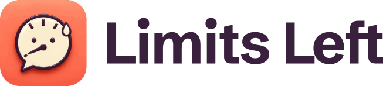

How it is set:

- **Face**: Schibsted Grotesk Bold (700), OFL, downloaded from Fontsource. It is sturdy and friendly, with open counters, and it matches the site's headings. Sentence case, one color, no single accented letter.
- **Spacing**: tracking -0.02 em. Word space 0.20 em instead of the font's wider default, so the two words read as one name. "Le" is kerned an extra -0.03 em to close the gap after the L's open arm.
- **ft join**: the t moves 0.045 em left so its crossbar overlaps the f's. Both bars sit at the same height in the font, so they merge into one level line, like a fill line on a gauge. This is the only custom detail.
- **Lockup**: the tile is 2.1 cap heights tall, the caps are centered on it, and the gap is 0.24 of the tile. The tile is the current artwork masked to a rounded square (22.5 percent radius) and embedded as a 384 px PNG data URI, so each lockup file stands alone (47 KB).

Source font: `latin-700-normal.ttf`, Schibsted Grotesk Bold, Latin subset, from the Fontsource package `@fontsource/schibsted-grotesk` version 5.3.0 (Google Fonts release v7, OFL-1.1). The font is not committed. Download it from <https://cdn.jsdelivr.net/fontsource/fonts/schibsted-grotesk@5.3.0/latin-700-normal.ttf> and check that its SHA-256 is `d7c4b81c2ff8e99614dd8b6ba40fce89e2073e596c2681ee975467106d5b0dcc` (56,268 bytes). With this file, the commands below reproduce all four committed SVGs byte for byte. The `-strip` option keeps ImageMagick from writing time stamps into the embedded PNG.

Rebuild: `source/outline_wordmark.swift` outlines the text with CoreText. `source/make_wordmark.py` writes the four SVGs. Run these from `assets/branding/wordmark/`.

```sh
curl -fL -o latin-700-normal.ttf https://cdn.jsdelivr.net/fontsource/fonts/schibsted-grotesk@5.3.0/latin-700-normal.ttf
echo "d7c4b81c2ff8e99614dd8b6ba40fce89e2073e596c2681ee975467106d5b0dcc  latin-700-normal.ttf" | shasum -a 256 -c
swift source/outline_wordmark.swift latin-700-normal.ttf "Limits Left" -0.02 0.2 "8:-0.03,10:-0.045" > outline.txt
magick ../nervous-gauge-artwork.png -resize 384x384 \( -size 384x384 xc:none -fill white -draw "roundrectangle 0,0 383,383 86,86" \) \
  -compose CopyOpacity -composite -dither None -colors 96 -strip PNG8:icon-384.png
python3 source/make_wordmark.py outline.txt icon-384.png .
```

### Wordmark concepts from Codex

Codex generated these three boards to explore direction only. None of them is the production wordmark.

| Concept | Note |
| --- | --- |
| 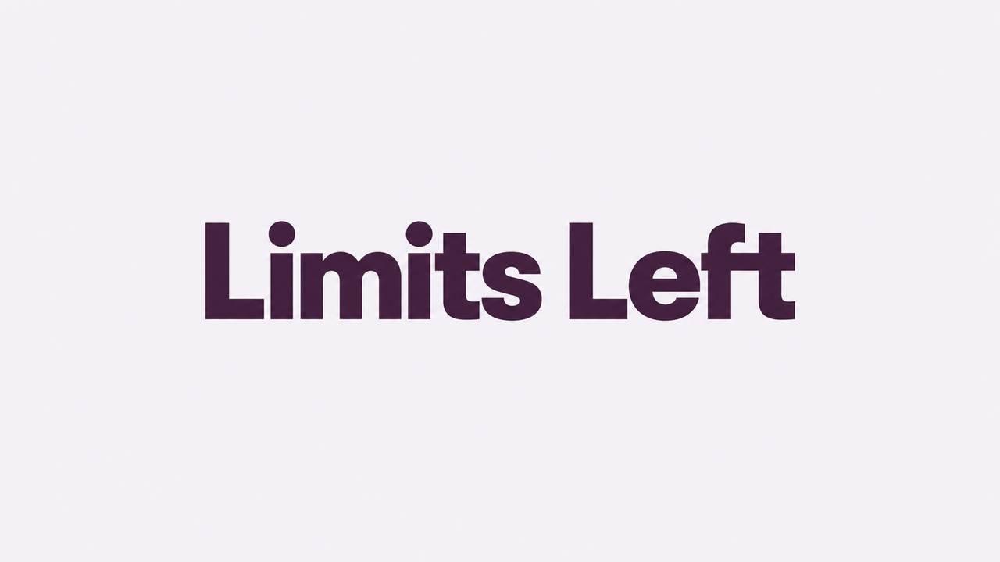 | `type-only.png`: a heavy grotesque with joined f and t crossbars. This board confirmed the ft join. Its letter spacing is too tight in "Limits". |
| 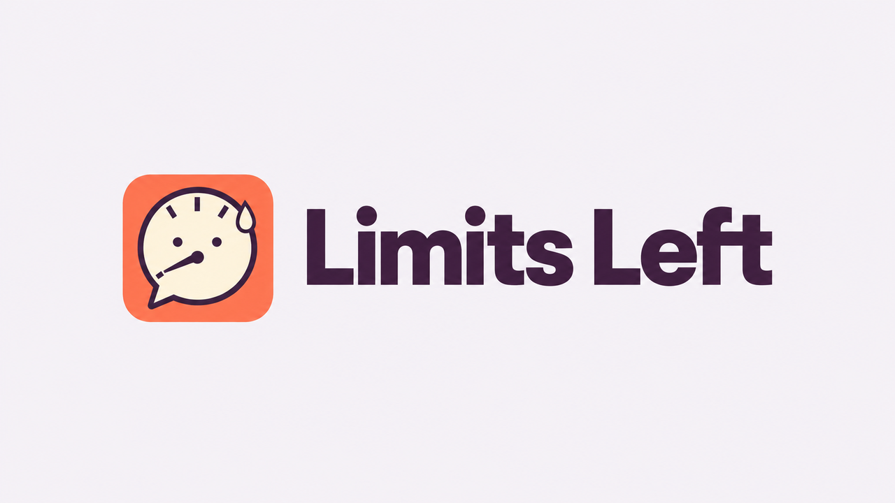 | `lockup.png`: icon tile and text on mist. Shows the scale of icon to text that the vector lockup also uses. |
| 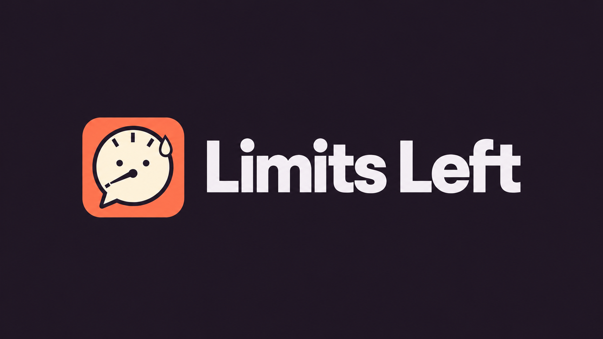 | `dark.png`: the same lockup on #1E1724 with off-white text. |

## Generation record

The Codex CLI 0.162.1 (`codex exec`, built-in image generation tool) made all images on October 16, 2026. That was **8 image generations** in total: five icon variations in one run with `nervous-gauge-artwork.png` attached, then three wordmark concepts in one run with the same file attached. No retries. Prompts contained only the design brief and palette values. The prompts asked for the same drawing, proportions, and pose; full-bleed square artwork with no tile, text, or watermark; and the material described in each note above. The wordmark prompt asked for exact spelling and sentence case, and forbade coloring one letter differently.

`contact-sheet.png` was built with ImageMagick and librsvg from the files in this folder. Labels are set in Schibsted Grotesk SemiBold.
