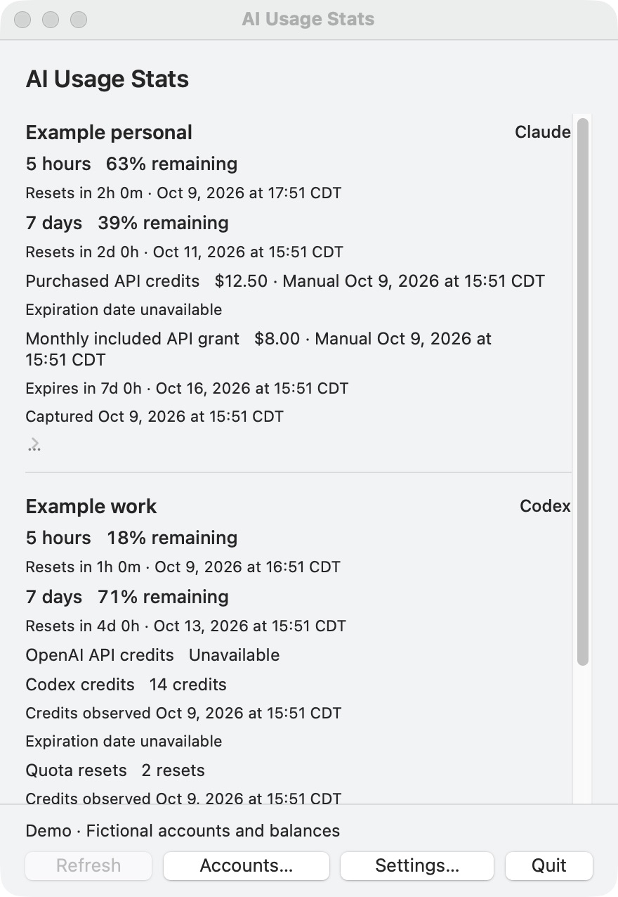
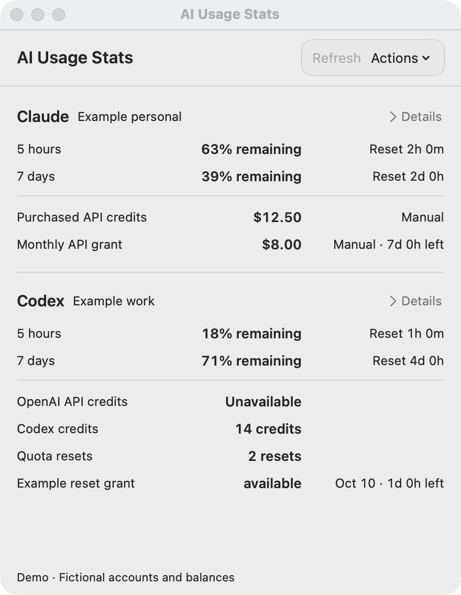
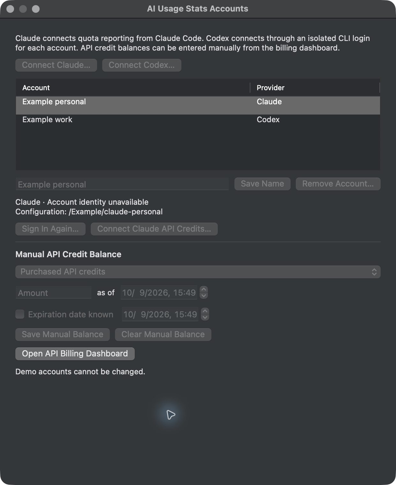
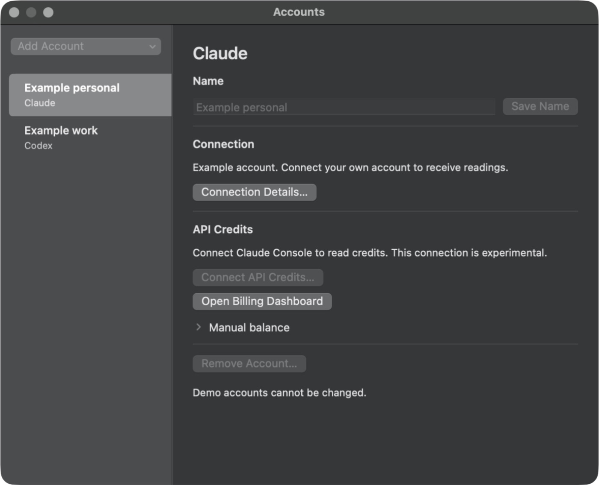

# Design critique

Initial interface reviewed October 9, 2026. Findings describe the captured design before revision.

## Scope and evidence

Native AppKit macOS menu bar utility, precise pointer and keyboard input. Primary task: compare multiple Claude and Codex accounts quickly, then inspect quota resets and API credit expiry.

Observed artifacts:

- `assets/design/before-panel-dark.png`: fictional two-account demo, validation window. Source content size is 440 × 610 points; capture is 880 × 1276 pixels including its title bar.
- `assets/design/before-accounts-dark.png`: fictional two-account demo, Accounts window. Source content size is 620 × 730 points; capture is 1240 × 1516 pixels including its title bar.
- `assets/design/before-panel-light.png`: same fictional two-account validation panel and point size in light appearance. Quota values, credit amounts, and labels remain readable; the same overflow, wrapped provenance, unaligned values, and glyph-only Details affordance are visible. This is visual evidence for D01 through D05 in both appearances, not a measured contrast result.
- `assets/design/before-accounts-light.png`: same fictional Accounts window in light appearance. The long introductory copy, largely empty table, mixed account/connection/balance form, and placeholder-only amount label reproduce D06. Disabled editing remains intentional in demo mode.

The demo deliberately disables account edits and Refresh. These disabled controls are not a production defect. A validation-window capture shows the panel content but does not prove the actual menu-bar popover's anchoring, material, dismissal, or screen-edge behavior.

Source inspected: `UsagePanelController.swift`, `InterfaceFormatting.swift`, `AccountsWindowController.swift`, `SettingsWindowController.swift`, `ApplicationDelegate.swift`, `DemoFixtures.swift`, and `docs/NATIVE-DESIGN.md`. Findings refer to the initial implementation captured before redesign.

Real empty/error/authentication states, VoiceOver reading, keyboard traversal, focus during a timed update, Reduce Transparency, Increase Contrast, and real menu-bar anchoring remain untested in this first pass. No numeric contrast or control-size claim is inferred from screenshots.

Apple primary sources were reviewed on October 9, 2026. The applicable guidance is to limit popovers to focused information, align content for scanning, prioritize clear hierarchy, use standard AppKit controls, and reserve Liquid Glass for functional controls above content. Use macOS control metrics rather than applying mobile touch-target or web viewport rules.

## Findings

### D01 · High · Routine two-account information extends below the visible panel

**Observed:** The Claude block occupies about half the content viewport. The Codex block begins near the middle; the final quota-reset credit and its expiry are below the viewport. The user must scroll even in the two-account demonstration to finish the core task.

**Source:** `UsagePanelController.accountRow` appends independent labels for each quota, every credit annotation, observation date, expiry, and fetch date. The fixed preferred size is 440 × 610 points.

**Correction:** Keep each account as a compact plain section. Use one quota row per window and one credit row per category. Keep the two-account default state readable without scrolling at the existing panel size; retain scrolling for additional accounts and expanded details. Do not solve this only by making the popover taller. Apple recommends a focused, appropriately sized [popover](https://developer.apple.com/design/human-interface-guidelines/popovers).

**Acceptance:** Both demo accounts' percentages, reset countdowns, known credit balances, and known expiry countdowns are visible in the initial panel.

### D02 · High · Exact timestamps compete with the decision information

**Observed:** Both resets include a full date, year, clock time, and time zone. The purchased-credit record repeats the observation timestamp, the monthly credit repeats it again, and a Captured timestamp follows. One monthly credit label wraps onto a second line. These long records receive nearly the same visual treatment as remaining quota.

**Source:** `InterfaceFormatting.reset` combines countdown with exact date unconditionally. `accountRow` prints manual dates, credit observation dates, and quota capture dates inline.

**Correction:** Display short reset and expiry countdowns in the default view. Put exact dates and detailed provenance in expanded Details. Keep one concise visible freshness indication per account and a visible Manual designation for manual credits. Stale quota and stale provider-credit states must remain visible where the corresponding value appears. Metadata should explain trust without taking over the layout, consistent with [Apple's hierarchy guidance](https://developer.apple.com/design/human-interface-guidelines/layout).

**Acceptance:** A user can tell “39% left, resets in 2 days” without reading a calendar date; opening Details reveals the complete time-zone-aware date and each observation source.

### D03 · Medium · Percentages and balances lack stable alignment

**Observed:** Each usage value starts after its duration label, while balance values start after much longer category labels. There is no shared right edge for the decision numbers. The eye must scan sentence fragments to compare 63%, 39%, 18%, and 71%.

**Source:** Usage and credit rows are single concatenated strings. Monospaced digits help glyph consistency but do not establish value columns.

**Correction:** Give quota rows separate label, value, and reset fields with consistent columns. Use strong monospaced digits for values, with an unambiguous “left” or “remaining” semantic. Align balances on a common trailing edge. Use native label colors and modest weight differences, with no decorative containers. A restrained usage indicator is optional only if it communicates the same percentage and has a text equivalent.

**Acceptance:** Values align across both accounts, and long labels wrap without shifting the value column or hiding the reset.

### D04 · Medium · The Details control does not visibly name its action

**Observed:** The collapsed Claude control appears as a small disclosure/ellipsis-like glyph beneath the account. The screenshot has no readable “Details” label. Its function is difficult to discover.

**Source:** The button is titled Details but uses `.disclosure` bezel styling. It has a descriptive accessibility label, but that does not replace visible affordance.

**Correction:** Use a standard disclosure control with an adjacent visible Details label, or a plainly titled native Details button with selected state. Preserve an account-specific accessible name and expose expanded/collapsed state.

**Acceptance:** A sighted user can identify the action immediately. Keyboard users can activate it, and VoiceOver announces the account and disclosure state. This follows [Apple's writing guidance](https://developer.apple.com/design/human-interface-guidelines/writing).

### D05 · Medium · Credit uncertainty is verbose, while credit kinds remain hard to compare

**Observed:** “Expiration date unavailable” consumes a line for purchased credits and another for Codex credits. “Credits observed” repeats for Codex credit types. Unknown API balance, known currency, credit units, and reset units all appear in the same vertical text sequence with similar styling.

**Source:** `accountRow` iterates all credit records and appends annotations separately. The model correctly distinguishes currency, credits, resets, manual sources, unlimited balances, unknown dates, and expiring grants.

**Correction:** Preserve those distinctions in compact rows. For example: Purchased API / $12.50 / Manual; Monthly grant / $8.00 / expires in 7d; Codex credits / 14 credits; Quota resets / 2 resets. Show an explicit unavailable balance when relevant, with the reason and recovery action in Details. Unknown expiry should appear in Details; known nonexpiry and imminent/expired state may warrant compact inline text. Do not add unlike units or infer a missing balance or expiry.

**Acceptance:** Credits remain separate from subscription quota. Zero, unavailable, unlimited, expired, and stale readings stay distinct. Exact grant records remain inspectable.

### D06 · Medium · Account setup mixes connection, identity, and manual billing in one long form

**Observed:** Accounts opens with a broad provider explanation, then connection buttons, a table with considerable unused height, a rename/delete row, configuration-path text, connection controls, and the full manual-balance form. The user encounters operational details before a clear account-editing structure.

**Source:** `AccountsWindowController.configure` builds one vertical stack. Provider-specific explanation also exists in the connection dialogs. The selected account's configuration path is printed directly in the main editor.

**Correction:** Structure the window around three clear groups: account selection/name, connection state/actions, and credit balance. Keep introductory copy short; leave the detailed provider connection explanation in the dialog where it is needed. Show relevant provider-specific connection actions and keep configuration details available below the primary state. Give Amount a persistent visible label, not only a disappearing placeholder. Move destructive Remove away from the routine Save Name action without inventing another confirmation step.

**Acceptance:** A user can name an account, understand whether quota reporting is connected, and choose automatic or manual API credit setup without reading the whole window. Long names and paths remain inspectable. No disabled-state defect is claimed from this demo capture.

### D07 · Medium · Timed updates replace the controls that may hold keyboard focus

**Evidence type:** Source-confirmed risk; runtime behavior untested. `UsagePanelController.render` removes every arranged subview and creates all rows again. `ApplicationDelegate.countdownElapsed` invokes this path once per visible minute. A focused Details or dashboard button can be removed during an update. Source preserves scroll offset and expanded-account IDs, but does not explicitly preserve the focused control.

**Correction:** Prefer changing existing value labels when only time text changes. If rebuilding rows is retained, capture the logical focused account/action and restore it after layout. Avoid stealing focus or changing reading order during refresh. Expose useful individual quota/credit semantics to accessibility rather than relying only on an aggregate row label.

**Acceptance:** With focus on Details, wait across a minute boundary and a refresh; focus remains on the same logical control. Repeat with VoiceOver. This is a required device test, not a screenshot-derived failure, under [Apple's accessibility guidance](https://developer.apple.com/design/human-interface-guidelines/accessibility).

## Three coherent improvements

1. **A compact comparison panel.** Each plain account section contains a stable account/provider header and aligned quota rows. Percentage is the primary number; the reset countdown is immediately adjacent. Known credits use aligned amount rows with concise source and expiry notes. Exact dates, grant detail, identity, and missing-balance explanations live behind a visible Details control. Retain visible stale/sign-in/error signals beside affected values.

2. **A native command layer with restrained material.** Keep content flat and readable. Use system popover behavior and standard AppKit controls for Refresh, Accounts, and Settings, allowing current macOS to supply its material. Place Refresh near the panel heading so the main recovery action is easy to find. Reduce the oversized four-button footer; Quit already has the standard application command. Do not add repeated custom glass panels, glows, pulsing indicators, or animated backgrounds. Apple describes Liquid Glass as a functional layer for controls and warns that repeated custom effects distract from content in [Adopting Liquid Glass](https://developer.apple.com/documentation/TechnologyOverviews/adopting-liquid-glass).

3. **An account editor with a clear task order.** Make account selection, naming, connection state, and credit configuration visually distinct with simple headings and separators. Keep the selected account obvious. Show precise connection actions where they apply, persistent field labels, and concise manual-balance trust information. Reuse system text fields, pickers, and date controls. Verify keyboard traversal, light/dark appearance, Increase Contrast, Reduce Transparency, and long content using the actual packaged app.

## Preservation requirements

- “Remaining” means 100 minus utilization, clamped to the meaningful percentage range. Do not silently flip to used percentages.
- Countdowns refer to provider reset/expiry timestamps; they do not predict provider refresh. At a passed reset show Reset due until a new reading arrives, and mark the old reading stale.
- Credits, money, and reset counts are independent quantities. Do not combine balances across accounts, categories, currencies, or units.
- Keep exact timestamps and manual/provider attribution available. Date unknown is different from does not expire.
- Preserve useful last known data when refresh fails, with an explicit stale/authentication state and a clear recovery action.
- Retain the modest visible-minute update interval; no continual animations or timers while the panel is closed.
- Use standard native light/dark materials and semantic colors. A dark validation-window screenshot alone cannot confirm Liquid Glass rendering or accessible contrast.

## Revision verification

The findings above preserve the original baseline. The independent comparison below records the same findings after implementation; it does not replace the baseline or introduce a new score.

### Evidence inspected

- `assets/design/after-panel-light.png`: actual packaged app in validation-window mode, fictional two-account demo. Content is now 440 × 540 points. All four quota percentages and reset countdowns, both Claude credit balances, Codex credits, quota-reset count, unavailable OpenAI API balance, and reset-grant expiry fit without scrolling. A single functional control group contains Refresh and Actions in the header; the content stays plain.
- `assets/design/after-panel-dark.png`: the same compact panel in dark appearance. All headline readings fit with the same alignment and visible Details controls.
- `assets/design/after-accounts-light.png` and `after-accounts-dark.png`: actual packaged Accounts window, 700 × 540 points. The account sidebar makes selection explicit. The main editor separates Name, Connection, and API Credits, keeps Manual balance collapsed initially, and places Remove separately.
- `assets/design/after-manual-editor-light.png` and `after-manual-editor-bottom-light.png`: the expanded manual form and its scrolled bottom. Persistent Category, Amount (USD), Confirmed, and Expires labels are visible; scrolling reaches both Save Balance and Clear Balance. Demo-disabled fields and actions are intentional.
- `assets/design/after-settings-dark.png`: a compact Settings window presents Launch at login and concise refresh/manual-balance behavior.
- `assets/design/after-panel-flat-dark.png`: app-local `--reduce-transparency` fallback capture. Header material is removed while labels and actions remain readable. This is a simulated fallback, not a test of the global macOS Reduce Transparency setting.
- `assets/design/after-stale-expiry-dark.png`: actual demo readings aged past five minutes. Both accounts show Stale. The reset grant keeps its full short date and remaining-time text on the first line, with Stale on a second line. All headline rows still fit without scrolling.
- `assets/design/after-keyboard-focus-dark.png`: expanded Claude details and keyboard focus on the following Codex Details control. The focused control is visible after the scroll region reveals it. The expanded section shows exact reset dates, source timestamps, manual attribution, and expiry details.
- `assets/screenshots/menu-bar.png`: the actual menu-bar popover in system light appearance, containing only fictional demo data. It shows all account percentages, credit values, reset countdowns, and known expiry without scrolling. Its native popover shape and functional header control material are visible; the verifier also confirmed the accessibility popover role. This establishes actual light popover presentation. Dark appearance was inspected in validation windows, not in a real popover.
- `assets/design/after-empty-light.png`: actual empty account list in a 440 × 250-point validation panel. A clear first-account prompt and separate Connect Claude / Connect Codex buttons replace fictional readings. The verifier opened the initial Claude connection dialog, checked its account-name field, default configuration-folder selection, and Choose Folder action, then canceled without saving a profile. Completed live sign-in remains unverified.
- Revised source: `UsagePanelController.swift`, `AccountSectionView.swift`, `InterfaceFormatting.swift`, and `AccountsWindowController.swift`. Source findings are separate from observed interaction results.

The implementation verifier reported that Details opens and reveals exact dates/provenance, Actions opens Accounts, selecting Codex hides the Claude connection action, the manual form scrolls through every field and save action, and Command-comma opens Settings. Those are reported runtime observations; the screenshots independently establish appearance and content.

The verifier initially found a keyboard loop failure before Details and a second focus-visibility failure when the following account was offscreen. Both were fixed and retested in the final packaged app: Tab reaches the first Details button, Space expands it, Tab reaches its dashboard action, and Shift-Tab returns. Focus stayed on the same Details button across a real countdown change from 2h to 1h 58m. Tabbing to the offscreen Codex Details button scrolls it into view above the footer. These are reported runtime results with the visible end state captured; VoiceOver and a live data-changing refresh remain untested.

### Finding status

| ID | Status | Before and after evidence |
| --- | --- | --- |
| D01 | Fixed in observed light/dark demo and real light popover | Before light/dark panels hide the final Codex grant and expiry. Both after windows and the real light menu-bar popover show all core readings without scrolling in 70 fewer content points of height. Additional accounts and expanded Details still require scrolling by design. |
| D02 | Fixed in observed summary and expanded Details | Before panels repeat full timestamps and wrap a monthly-credit line. Both after panels show compact countdowns, visible Manual attribution, and no repeated date lines. The expanded keyboard-focus capture shows exact dates, expiry, and observations still available in Details. |
| D03 | Fixed in observed light/dark and stale demo | Both after panels align percentages and balances on one trailing edge and reset/expiry information in a consistent timing column. Values retain explicit remaining, currency, credits, and reset units. The stale capture preserves complete expiry text. Long provider labels remain untested. |
| D04 | Visible affordance, pointer, and keyboard activation fixed | Both after panels show a readable Details label and chevron. The verifier confirmed opening Details with Space and reaching its dashboard action with Tab. Source exposes account names and Expanded/Collapsed state. VoiceOver remains untested. |
| D05 | Fixed in observed summary and aged stale-expiry case | After panels separate quota from credits, preserve unavailable balance and Manual attribution, and show reset-grant date/countdown. In the actual aged demo capture, the full expiry date/countdown stays visible with Stale on a separate line; both accounts still fit. Unknown-expiry bookkeeping remains inspectable in expanded Details. |
| D06 | Fixed in observed Accounts, manual form, and empty-state entry | Before Accounts shows a long mixed form. After captures show the selected account sidebar, Name/Connection/API Credits groups, a collapsed manual editor, persistent form labels when expanded, and a separated Remove action. The bottom capture shows save/clear controls remain reachable by scrolling. Empty-state buttons clearly offer provider setup; the initial Claude dialog was inspected and canceled. Completed live setup and saving remain unverified. |
| D07 | Fixed for verified keyboard and minute-update paths | Countdown updates change existing account sections and keep disclosure/dashboard controls. The verifier confirmed Tab/Space/Shift-Tab traversal, stable Details focus across a real minute update, and automatic reveal of offscreen Codex Details. The final focus capture corroborates visibility. VoiceOver and a live data-changing refresh remain untested. |

No unresolved major design issue was found in the inspected after captures and reported keyboard paths. The stale-expiry case, keyboard focus visibility, empty-state entry, and real light menu-bar popover were verified. Live sign-in, billing extraction, all error/authentication states, real dark popover appearance, VoiceOver, live refresh focus, and global accessibility display settings are not established by this evidence.

### Before and after gallery

The gallery compares the same fictional two-account task and appearance. The after panel has less content height; the Accounts window uses a wider, shorter arrangement. Captures include window title bars.

| Surface | Before | After |
| --- | --- | --- |
| Panel, light |  |  |
| Accounts, dark |  |  |

Supplemental captures: [dark panel](../../assets/design/after-panel-dark.png), [light Accounts](../../assets/design/after-accounts-light.png), [expanded manual form](../../assets/design/after-manual-editor-light.png), [manual form bottom](../../assets/design/after-manual-editor-bottom-light.png), [Settings](../../assets/design/after-settings-dark.png), [simulated flat fallback](../../assets/design/after-panel-flat-dark.png), [stale expiry](../../assets/design/after-stale-expiry-dark.png), and [keyboard focus](../../assets/design/after-keyboard-focus-dark.png).

Final native evidence: [actual light menu-bar popover](../../assets/screenshots/menu-bar.png) and [empty first-account panel](../../assets/design/after-empty-light.png).
